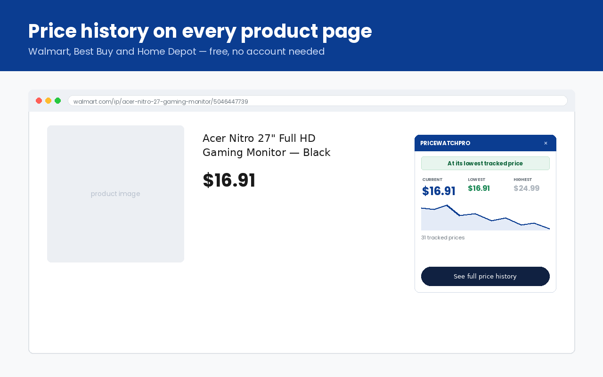

# PriceWatchPro browser extension

Price history right on **Walmart, Best Buy and Home Depot** product pages.

Open a product page and a small panel shows the item's current price, the lowest and highest
prices [PriceWatchPro](https://www.pricewatchpro.com/) has recorded, a chart of every change,
and an "At its lowest tracked price" flag when today's price is the lowest on record. It's the
quickest way to check whether a sale is a real price drop.

- **Website:** https://www.pricewatchpro.com/
- **Chrome Web Store:** https://chromewebstore.google.com/detail/kcfdlaodpbkjmedljhoebjbpahocopap
- **Firefox Add-ons:** https://addons.mozilla.org/firefox/addon/pricewatchpro-price-tracker/
- **About the extension:** https://www.pricewatchpro.com/chrome-extension
- **Project page:** https://moemawari.github.io/pricewatchpro-extension/

Free, no account needed.

## Where it works

| Store | Product pages | Price history on the web |
|---|---|---|
| Walmart | `walmart.com/ip/…` | [Walmart price tracker](https://www.pricewatchpro.com/walmart) |
| Best Buy | `bestbuy.com/site/…` and `bestbuy.com/product/…` | [Best Buy price tracker](https://www.pricewatchpro.com/bestbuy) |
| Home Depot | `homedepot.com/p/…` | [Home Depot price tracker](https://www.pricewatchpro.com/homedepot) |

Browsers: desktop Chrome, Microsoft Edge, Brave and Opera, and desktop Firefox 140 or later. The Firefox
package is generated from the same files by `build_firefox.py`.

## What you get

- A price history panel on the product page: current, lowest and highest recorded price, and a chart
- A toolbar popup with a short written analysis, such as how today's price compares with its 90-day average
- One click to the full chart on pricewatchpro.com, where you can set a free price-drop email alert
- "Track this item" for products that aren't tracked yet, where the store supports it (currently Walmart)

Around Black Friday, the [Black Friday price check](https://www.pricewatchpro.com/black-friday)
compares this year's prices with last year's for the same products.

## Privacy

The extension has no analytics and no tracking, and it doesn't read your browsing history.

On a supported product page it sends **only that product's public item number** to
`https://www.pricewatchpro.com/api/extension` to look up its price history, without cookies
(`credentials: "omit"`). Clicking "Track this item" sends the same item number to start tracking
it. Nothing else leaves your browser. All network calls are in [`background.js`](background.js).

Full policy: https://www.pricewatchpro.com/privacy

## How it works

Plain JavaScript and CSS, no build step and no third-party libraries.

| File | Role |
|---|---|
| `manifest.json` | Manifest V3: content-script matches and permissions (`storage`, `activeTab`, pricewatchpro.com) |
| `shared.js` | Reads the store and item number from the page URL; money formatting |
| `content.js` | Renders the on-page panel |
| `background.js` | Every network call (price lookup, track request), with a small in-memory cache |
| `popup.html` / `popup.js` | Toolbar popup |
| `panel.css` | Panel styles, all scoped under `.pwp-*` |
| `build_firefox.py` | Writes the Firefox package from the same files (only the manifest differs) |

Best Buy's newer `/product/<slug>/<id>` URLs don't contain the numeric SKU, so the content script
reads it from the page instead (the page's metadata first, then the visible "SKU" text).

How PriceWatchPro collects and checks prices: https://www.pricewatchpro.com/how-we-track-prices

## Run it from source

1. Download or clone this repository.
2. Open `chrome://extensions` and turn on **Developer mode**.
3. Click **Load unpacked** and pick this folder.
4. Open a product page, for example a Walmart `walmart.com/ip/…` page. The panel appears at the bottom right.

Firefox: run `python3 build_firefox.py`, then in Firefox open `about:debugging` → This Firefox →
**Load Temporary Add-on** and pick the zip it wrote.

## Support

Questions, or a product we don't track yet: support@yaya-tech.com or https://www.pricewatchpro.com/contact

PriceWatchPro is an independent price tracker and isn't affiliated with or endorsed by Walmart,
Best Buy or Home Depot.

© 2026 YAYA APPS, LLC. All rights reserved.
